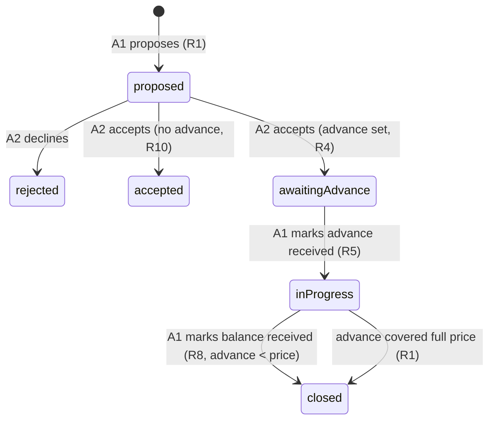

## Goal Capsule

- **Objective:** Freelancers using ScopeFirm can gate extra work on money actually arriving: a proposed change order carries a client-payable advance, the client pays it through the button on the approval page, and work visibly starts only when the freelancer marks that advance received.
- **Product authority:** The ScopeFirm owner, from the 2026-10-11 brainstorm and the product audit at `docs/ScopeFirm-Audit-2026-09-28-Reaudit.pdf`.
- **Stop conditions:** Existing quotes and no-advance change orders must behave identically to today; the build, lint, and new tests must pass.
- **Open blockers:** None.

## Product Contract

Product Contract unchanged from the requirements-only brainstorm (R1–R10, Key Decisions, A1–A2, F1–F4, AE1–AE6, Success Criteria, Scope Boundaries, Dependencies/Assumptions all preserved verbatim below).

### Summary

Add an advance-gate to change orders. The freelancer sets an optional advance amount when proposing a change; the client accepts and pays the advance via UPI (India/INR) or the payment link (everywhere else); the order shows an awaiting-advance state until the freelancer marks the advance received, which flips it to in progress. Any remaining balance gets its own pay button and a final received mark, and every proposed change can be copied as a WhatsApp message so the gate is discovered on the channel clients already use.

### Problem Frame

Scope creep is the number-two pain for freelance web builders, and ScopeFirm already lets a freelancer propose paid change orders on an accepted quote. But nothing connects the money to the work: a client can accept extra work, the full-price pay button sits undiscovered on a link nobody reopens, and the freelancer starts working on trust. The 2026-09-28 audit found exactly one angle no competitor had shipped — a change approval that collects a UPI advance before extra work starts, shared over WhatsApp. This plan builds that wedge on top of the existing change-order and UPI machinery.

### Requirements

**Advance on change orders**

- R1. When proposing a change order, the freelancer may set an advance amount that does not exceed the change price.
- R2. The advance amount is stored on the change order and shown to both parties wherever the change price is shown.
- R3. Editing the advance amount after it was marked received clears the received mark, mirroring the existing quote-level advance rule.

**Advance gate states**

- R4. When the client accepts a change order that has an advance, the order enters an awaiting-advance state showing the advance amount with the same payment options the app already offers (UPI button for India/INR quotes with a UPI ID, online payment link otherwise).
- R5. When the freelancer marks the advance received, the order flips to an in-progress state and a dated history entry is written.
- R6. The awaiting-advance and in-progress states are visible on both the client approval page and the private tracker.

**Balance settlement**

- R7. When the advance is less than the change price, the client page shows the remaining balance with payment options after the advance is marked received.
- R8. Marking the balance received closes the order out fully and writes a dated history entry.

**Sharing**

- R9. Each proposed change order gets a one-tap copy action for a WhatsApp-ready message containing the change title, price, advance due, and the client approval link, following the existing share-message pattern.

**Compatibility**

- R10. Change orders without an advance keep today's behavior exactly: accept, pay full price, freelancer marks received.

### Key Decisions

- **Advance amount is freelancer-set per change order** (session-settled: user-directed — chosen over a fixed global percentage and over advance-equals-full-price: flexible for 50%, flat-₹, and full-price cases without a settings surface). Governs R1.
- **Two-step gate with visible states** (session-settled: user-directed — chosen over forcing payment before accept and over leaving states untouched: ScopeFirm cannot verify UPI, so the honest gate is a visible state the freelancer flips, not an enforced button press). Governs R4, R5, R6.
- **Gate applies to all regions, UPI preferred** (session-settled: user-directed — chosen over India-only and over UPI-any-region: same states everywhere; the payment rail is chosen by what the quote already supports). Governs R4.
- **Balance stays per change order with its own pay button** (session-settled: user-directed — chosen over settling the remainder offline and over pooling a grand balance across quote and changes: the complete money loop stays in ScopeFirm and existing running-total math is untouched). Governs R7, R8.
- **Notification is a per-change copy-WhatsApp-message action** (session-settled: user-directed — chosen over automatic email and over no notification: extends the existing share-message pattern and delivers the audit's wedge on the channel clients actually use, with no email dependency). Governs R9.

### Actors

- A1. The freelancer: proposes changes with advances, shares them, marks advance and balance received.
- A2. The client: opens the approval link, accepts or declines changes, pays the advance and balance through the shown buttons. Identity is not verified, as everywhere in ScopeFirm.

### Key Flows

- F1. Propose and share a gated change
  - **Trigger:** A1 proposes a change order on an accepted quote and sets an advance.
  - **Actors:** A1
  - **Steps:** The order is recorded with price and advance; A1 taps the copy action and pastes the message into WhatsApp.
  - **Covers:** R1, R2, R9

- F2. Client accepts and pays the advance
  - **Trigger:** A2 opens the client link and accepts a proposed change that has an advance.
  - **Actors:** A2
  - **Steps:** The order enters awaiting-advance; A2 sees the advance amount with the UPI button or payment link and pays directly; nothing ScopeFirm can verify happens here.
  - **Covers:** R4, R6, R10

- F3. Advance received, work starts
  - **Trigger:** A1 sees the money arrive and marks the advance received.
  - **Actors:** A1
  - **Steps:** The order flips to in progress with a dated history entry; A2 sees work has started; if the advance was partial, the balance with its pay button appears.
  - **Covers:** R5, R6, R7

- F4. Balance settled
  - **Trigger:** A2 pays the balance and A1 marks it received.
  - **Actors:** A2, A1
  - **Steps:** The order closes out fully with a dated history entry.
  - **Covers:** R8

The change-order lifecycle these flows produce:

### Acceptance Examples

- AE1. Advance equals full price
  - **Covers:** R1, R7
  - **Given:** A1 proposes a ₹6,000 change with a ₹6,000 advance.
  - **When:** A2 accepts and A1 later marks the advance received.
  - **Then:** The order goes awaiting-advance → in progress with no balance step, and one history entry for the advance receipt exists.

- AE2. Partial advance produces a balance
  - **Covers:** R7, R8
  - **Given:** A ₹15,000 change with a ₹5,000 advance, accepted by A2.
  - **When:** A1 marks the advance received.
  - **Then:** The client page shows "balance due ₹10,000" with payment options; after A1 marks the balance received, the order closes with a second history entry.

- AE3. Non-India quote keeps the same states
  - **Covers:** R4
  - **Given:** An OTHER-region quote in USD with a payment link and no UPI ID.
  - **When:** A2 accepts a change with an advance.
  - **Then:** The order still enters awaiting-advance and shows the payment link instead of a UPI button; state names and transitions are identical.

- AE4. Editing a received advance clears the mark
  - **Covers:** R3
  - **Given:** A ₹5,000 advance was marked received on a change order.
  - **When:** A1 edits that change order's advance to ₹7,000.
  - **Then:** The received mark clears and the order returns to awaiting-advance until A1 marks the new amount received.

- AE5. Orders without an advance are unchanged
  - **Covers:** R10
  - **Given:** A change order proposed with price but no advance.
  - **When:** A2 accepts it.
  - **Then:** Behavior matches today: full-price payment options and the existing single mark-received action, with no awaiting-advance state.

- AE6. The WhatsApp message carries what the client needs
  - **Covers:** R9
  - **Given:** A proposed change titled "Add contact form" priced ₹8,000 with a ₹3,000 advance on project "Brochure site".
  - **When:** A1 taps the copy action on the tracker.
  - **Then:** The clipboard holds a message containing the title, the ₹8,000 price, the ₹3,000 advance due, and the public client link — and no editor key.

### Success Criteria

- The full wedge runs end-to-end on a phone: proposal → WhatsApp → client accepts → UPI tap → advance marked → in progress, with no step requiring a tool outside ScopeFirm.
- Existing quotes and change orders created before this feature behave identically after the change, with no data migration step required from the freelancer.

### Scope Boundaries

- Deferred for later: email notification of proposed changes, automated payment verification of any kind, client identity verification, fixing the DRAFT-status leakage and the missing quote dashboard flagged by the audit, pooled grand-balance accounting across quote and changes, and .ics reminder integration for awaiting-advance orders.
- Outside this product's identity: ScopeFirm never holds, moves, or verifies money; every "received" mark is the freelancer's own record, stated as such in the UI as it is today.

### Dependencies / Assumptions

- The existing change-order machinery (proposal, accept/decline, mark received, history entries) is the base; this plan extends it rather than replacing it. Verified in `src/lib/store.ts` and `src/app/q/[id]/page.tsx`.
- R3 assumes the quote-level reset rule (a changed advance clears its received mark, `src/lib/store.ts` updateQuote) is the pattern to mirror; the user accepted this as an assumption in the synthesis.
- Payment options, UPI-ID gating, and the "ScopeFirm does not process or verify payments" disclaimers already exist and are reused unchanged for advance and balance amounts.

### Sources / Research

- Product audit: `docs/ScopeFirm-Audit-2026-09-28-Reaudit.pdf` — verdict and the India-specific UPI-advance-over-WhatsApp wedge this plan implements.
- Code grounding: `src/lib/store.ts` (quotes and change_orders schema, advance reset rule, history kinds), `src/app/actions/index.ts` (server actions), `src/app/q/[id]/page.tsx` (client view), `src/app/quotes/[id]/page.tsx` (tracker), `src/app/components/payment-options.tsx` (payment rails), `src/app/components/share-link.tsx` (share-message pattern).

---

## Planning Contract

### Key Technical Decisions

- KTD1. Gate states are stored values on the existing `change_orders.status` column (`awaiting_advance`, `in_progress`), not derived from timestamps. Every existing view and history writer already switches on stored status, so stored states keep one source of truth and R10's path untouched. Full-state map: `proposed → accepted` (no advance, unchanged) and `proposed → awaiting_advance → in_progress` (advance set); full settlement keeps the existing `paid_at` timestamp as the close signal, so no third new state is needed.
- KTD2. The schema grows two nullable columns (`advance_amount REAL`, `advance_paid_at TEXT`) added with the same tolerated-failure `ALTER TABLE` pattern already used for `paid_at`, so existing databases migrate on first init with no operator step (supports Success Criteria 2).
- KTD3. Two distinct received-marks exist per the Product Contract: `advance_paid_at` (R5, flips state) and the existing `paid_at` (R8, closes the order) — for advance orders `paid_at` marks the balance, for no-advance orders it behaves exactly as today (R10). One order, one close timestamp, no extra status.
- KTD4. R3's reset rule is a store-level invariant with no new edit UI: change orders have no edit path today, so `advance_amount` is immutable after insert and the received mark cannot be invalidated; a code comment at the change_orders schema records the rule for the first future edit flow. Chosen over adding an edit form, which the Product Contract's scope boundaries deferred. (Confirmed with the requester in the plan-time synthesis.)
- KTD5. The repo has zero test infrastructure; a minimal Vitest setup (dev dependency, `test` script, no CI change) covers the store-level state machine and money-adjacent logic, because this feature adds financial states to an untested table. CI stays lint+build+audit; wiring tests into CI is deferred.
- KTD6. The client accept path adds no new rate limit: `respondToChangeOrder` already shares the per-quote `respond` budget, and the new editor mark-received actions stay cookie-authenticated like the existing ones (no new limit, consistent with `markAdvancePaidAction`).

### Assumptions

- The quote-level advance reset rule in `updateQuote` is the intended precedent for R3, per the brainstorm synthesis.
- `file:` local SQLite (and libSQL) accepts the additive `ALTER TABLE` migrations in dev and test the same way the existing `paid_at` migration does.

### Sequencing

U1 (store + migration) → U2 (server actions) → U3 (client view) → U4 (tracker + share). U3 and U4 depend on U1–U2 and are independent of each other. Tests in U1 land with the code they cover.

---

## Implementation Units

### U1. Schema migration and store state machine

- **Goal:** Persist the advance on change orders and implement the gate's state transitions and received-marks in the store layer.
- **Requirements:** R1, R2, R3 (invariant), R5, R8 (store side), R10.
- **Dependencies:** none.
- **Files:** `src/lib/store.ts`, `src/store.test.ts`
- **Approach:**
  1. Add `advance_amount REAL` and `advance_paid_at TEXT` to `change_orders` with the tolerated `ALTER TABLE` pattern used for `paid_at`; extend the `ChangeOrder` type accordingly.
  2. Extend `addChangeOrder` input with `advance_amount: number | null`, inserted with the order; record the KTD4 invariant comment at the schema definition.
  3. Make `decideChangeOrder` advance-aware: acceptance sets `awaiting_advance` when an advance is present, `accepted` otherwise (R10's path byte-identical); decline stays `rejected`.
  4. Add `markChangeOrderAdvancePaid(q, orderId)`: guarded update setting `advance_paid_at` and status `in_progress` only while status is `awaiting_advance`, with a `change_advance_paid` history entry in the `change_paid` note style (manual record, not verified).
  5. Extend `markChangeOrderPaid` so that on an `in_progress` order it records the balance receipt (`paid_at` + existing `change_paid` history kind); on a no-advance `accepted` order it behaves exactly as today.
- **Patterns to follow:** `markAdvancePaid` and `markChangeOrderPaid` for guarded single-transaction updates with history; the `paid_at` column addition for migrations.
- **Test scenarios:**
  - Adding an advance to `addChangeOrder` persists it and the proposed order reads back with `advance_amount` set.
  - `decideChangeOrder('accepted')` on an order with an advance lands in `awaiting_advance`; without an advance lands in `accepted`.
  - Declining an order with an advance lands in `rejected`.
  - `markChangeOrderAdvancePaid` on an `awaiting_advance` order sets `advance_paid_at`, flips to `in_progress`, and writes exactly one `change_advance_paid` history row.
  - `markChangeOrderAdvancePaid` on an order not in `awaiting_advance` returns false and writes no history.
  - Covers AE1: advance equal to price — after advance receipt the order is `in_progress` with `paid_at` still null and no balance due.
  - Covers AE2: partial advance — `markChangeOrderPaid` on the `in_progress` order sets `paid_at`, writes one `change_paid` history row, and balance computes as price minus advance.
  - No-advance order regression: the full accept → `markChangeOrderPaid` sequence produces the same statuses, timestamps, and history kinds as before this change.
- **Verification:** `npm test` green; `npm run build` still compiles.

### U2. Server actions for the advance field and mark actions

- **Goal:** Accept the advance through the propose form and expose the editor mark-advance-received action.
- **Requirements:** R1 (validation), R5 (action), R8 (action).
- **Dependencies:** U1.
- **Files:** `src/app/actions/index.ts`
- **Approach:**
  1. Extend the `newOrder` schema with an optional `advance_amount` using the same field shape `quoteFields` uses, plus the same `advance <= price` refine (mirrors the existing quote rule text).
  2. Pass `advance_amount` through `proposeChangeOrder` into `addChangeOrder`.
  3. Add `markChangeOrderAdvancePaidAction` mirroring `markChangeOrderPaidAction`: editor-cookie auth, `order_id` parse, call the U1 store function, revalidate tracker and client paths.
  4. Leave `respondToChangeOrder` and `markChangeOrderPaidAction` signatures unchanged; the state-awareness lives in the store (KTD1).
- **Patterns to follow:** `proposeChangeOrder` and `markChangeOrderPaidAction` for the action shape; `quoteFields` for the advance field's zod shape and refine.
- **Test scenarios:**
  - Proposing with an advance greater than the price fails validation and creates no order.
  - Proposing with a valid advance creates the order with the advance persisted.
  - Proposing with an empty advance field creates a no-advance order.
  - `markChangeOrderAdvancePaidAction` without the editor cookie redirects without mutating state.
- **Verification:** `npm run build` compiles the new action; U1 tests still green.

### U3. Client approval page: gate states and balance

- **Goal:** Show the awaiting-advance state with the advance pay button, the in-progress state, and the balance due pay button to the client.
- **Requirements:** R4, R6, R7, R10.
- **Dependencies:** U1, U2.
- **Files:** `src/app/q/[id]/page.tsx`
- **Approach:**
  1. In the change-order card, branch on order status: `awaiting_advance` renders "Advance due" with `PaymentOptions` at the advance amount (purpose names the change); `in_progress` renders "Work in progress", plus — when price minus advance is positive — "Balance due" with `PaymentOptions` at the balance; `accepted` (no advance) renders exactly today's full-price block; `paid_at` present renders today's received line.
  2. Keep the proposed-state accept/decline forms unchanged; keep the running-total math untouched (R7 is per-order).
  3. Reuse existing disclaimers; no new copy beyond state labels and amounts.
- **Patterns to follow:** the existing order-card branch in the same page; `PaymentOptions` for rails and disclaimers.
- **Test scenarios:**
  - Covers AE3: an OTHER-region quote with a payment link and no UPI ID shows the link (never a UPI button) on the awaiting-advance card.
  - Awaiting-advance card shows the advance amount, not the full price.
  - In-progress card with partial advance shows balance equal to price minus advance.
  - In-progress card with full-price advance shows no balance block.
  - No-advance accepted order renders the same buttons and amounts as before the change.
- **Verification:** `npm run build` green; manual render check of the four card states via a seeded local quote.

### U4. Tracker: advance controls and per-change WhatsApp share

- **Goal:** Give the freelancer the advance field, the two mark-received controls, state pills, and the one-tap WhatsApp message per proposed change.
- **Requirements:** R1, R2 (editor side), R5 (control), R6 (tracker side), R8 (control), R9.
- **Dependencies:** U1, U2.
- **Files:** `src/app/quotes/[id]/page.tsx`, `src/app/components/change-order-share.tsx`
- **Approach:**
  1. Add an optional advance input to the propose form, labeled next to the price field.
  2. Extend the tracker order card: state pill for `awaiting_advance`/`in_progress`, "Mark advance received" on awaiting-advance orders, and the existing mark-received button becomes the balance action on `in_progress` orders (unchanged label and behavior for no-advance orders).
  3. Add `change-order-share.tsx`, a small client component copying the share-link.tsx clipboard pattern, rendering one copy button per proposed order; the message carries title, price, advance due (when set), and the public client link — never the editor key.
- **Patterns to follow:** `share-link.tsx` for clipboard + copied-state UI; the tracker's existing order form and pill rendering.
- **Test scenarios:**
  - Covers AE6: the copied message for a proposed order contains title, price, advance due, and the `/q/<id>` link, and does not contain the edit key.
  - The share button renders only on proposed orders.
  - The tracker shows the awaiting-advance pill and mark-advance button only while the store status is `awaiting_advance`.
  - Marking the advance received re-renders the card as in progress with the balance action.
- **Verification:** `npm run build` and `npm run lint` green; clipboard content checked in the browser.

---

## Verification Contract

| Gate | Command | Applies to |
|---|---|---|
| Unit tests | `npm test` | U1 state machine, U2 validation |
| Production build | `npm run build` | all units |
| Lint | `npm run lint` | all units |
| Manual render | Seed a local accepted quote with one no-advance and one advance change order; walk the client and tracker pages through all states | U3, U4 |

No `release:validate` exists in this repo; CI (`.github/workflows/ci.yml`) already runs lint, build, and audit and needs no change (KTD5).

## Definition of Done

- Every requirement R1–R10 is implemented and traceable to a unit; no-advance change orders behave identically to pre-change behavior (R10 verified by regression scenario and manual walk).
- `npm test`, `npm run build`, and `npm run lint` all exit 0.
- The manual render walk covers: proposed with and without advance, awaiting-advance on IN/INR (UPI button) and OTHER (payment link), in-progress with partial and full advance, and balance settlement.
- No abandoned-attempt or experimental code remains in the diff; migrations apply cleanly on an existing `scopefirm.db` created before the change.
