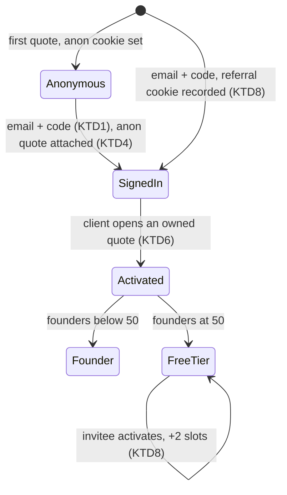
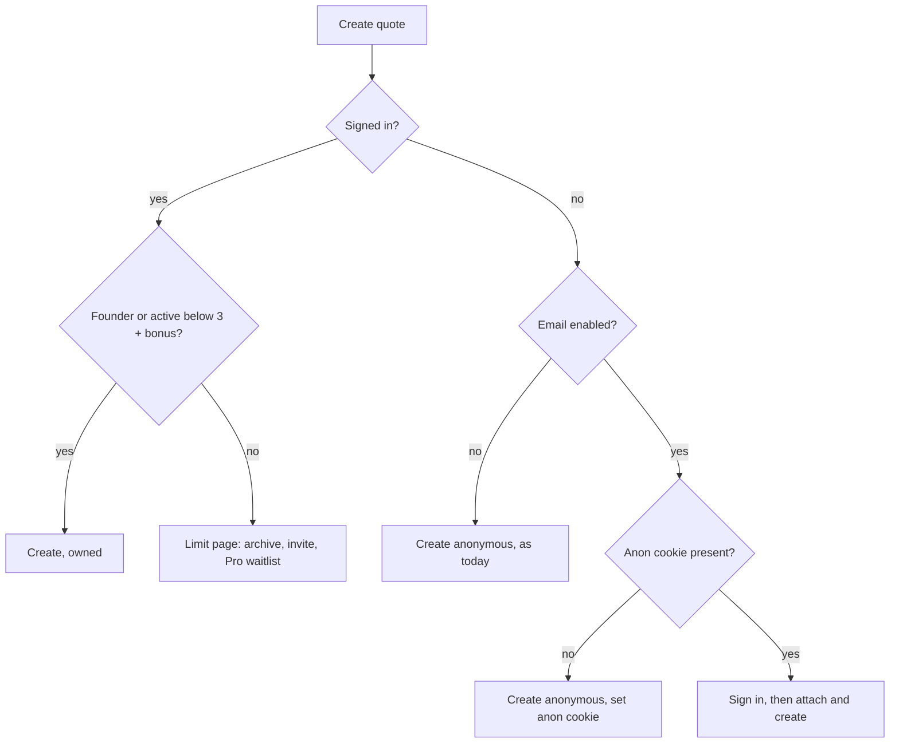

# Freelancer Accounts and Monetization Base - Plan

## Goal Capsule

- **Objective:** Freelancers can sign in and see all their quotes in one place. FirmQuote can reward its first 50 real users, cap free usage, and grow through referrals, all without taking payment yet.
- **Product authority:** The FirmQuote owner, from the 2026-10-15 brainstorm, using `docs/research/2026-10-15-competitors-gaps-monetization.md`. Notifications, quick change orders, branding and paid Pro checkout are not active scope.
- **Means:** Email-code accounts with a session cookie, an ownership column on quotes, and activation hooked into the existing client-view counter (KTD1–KTD5).
- **Stop conditions:** Existing quotes, editor links, client approval and change-order flows behave as before (R19). `npm test`, `npm run lint` and `npm run build` pass. Flows F1–F4 pass in a real browser.
- **Execution profile:** One PR, together with the already-implemented advance-gated change orders (`docs/plans/2026-10-11-1446-feat-upi-advance-change-orders-plan.md`).
- **Open blockers:** None.

Product Contract preservation: Product Contract unchanged.

---

## Product Contract

### Summary

Freelancers sign in with a 6-digit email code and get a "My quotes" dashboard. The first quote still needs no signup. The first 50 freelancers whose quote a client actually opens become Founders with unlimited free use for life. Everyone else gets 3 active quotes free, earns +2 slots per activated referral, and sees a Pro waitlist prompt at the limit.

### Problem Frame

FirmQuote identifies a freelancer only through a per-quote editor link or a 30-day browser cookie. A freelancer with several quotes has no single place to find them; the 2026-09-28 audit flagged the missing dashboard. With no notion of who a user is, FirmQuote cannot count users, reward early adopters, apply a free limit, or credit referrals. Every monetization path in the research doc is blocked on this. The closest competitor, Wesorder, already runs a free-for-life early-access offer with $0, free and $12 tiers, so the window to build an early user base with a founding offer is open now.

### Actors

- A1. Freelancer: creates quotes, signs in, manages their dashboard, invites others.
- A2. Client: opens the quote link and approves. Never signs in; behavior unchanged.
- A3. Invitee: a freelancer who arrives through another freelancer's invite link.

### Key Decisions

- **First quote needs no signup; the second asks for sign-in** (session-settled: user-directed — chosen over always requiring sign-in and over unlimited anonymous use: keeps the no-signup hook while making limits enforceable). Governs R4, R5.
- **First 50 activated freelancers are Founders, free for life; everyone else gets 3 active quotes** (session-settled: user-directed — chosen over 100 spots and over 12-month founder access: real scarcity and urgency at a manageable lifetime cost). Governs R9, R10, R11, R13.
- **Referral reward is +2 active quote slots for both people, up to 10 referrals** (session-settled: user-directed — chosen over a month of unlimited use and over deferring referrals: redeemable today without billing, and never expires mid-project). Governs R15, R16, R17.
- **Activation means a client opened the quote link**, not the freelancer's own preview. One definition for Founder spots and referral credit stops empty signups from gaming either. Governs R10, R16.
- **Sign-in uses a 6-digit email code**, reusing the email channel that already verifies client acceptance. No passwords and no third-party identity provider. Governs R1.
- **The limit blocks only new quote creation**; existing quotes keep working, so no client approval ever breaks mid-project. Governs R12.

### Requirements

**Sign-in and accounts**

- R1. A freelancer signs in by entering their email and then a 6-digit code sent to it. The code is single-use and expires.
- R2. A signed-in freelancer stays signed in on that browser until they sign out, and can sign out at any time.
- R3. An account is identified by its email address; signing in again with the same email reaches the same account.
- R4. A visitor who is not signed in can create exactly one quote with no signup, exactly as today.
- R5. When a not-signed-in visitor who already created a quote on this browser tries to create another, they are asked to sign in first. After sign-in, the earlier quote is attached to their account.
- R6. A signed-in freelancer can claim any quote they hold the editor access for (cookie or private editor link) into their account from that quote's tracker.

**Dashboard**

- R7. A signed-in freelancer has a "My quotes" page listing every quote in their account with client, project, status, price and last update, newest first.
- R8. The freelancer can archive a quote and unarchive it from the dashboard. Archived quotes are listed separately and remain fully viewable.

**Founding 50 and free limit**

- R9. The first 50 accounts to activate become Founders, permanently. Founders have no active-quote limit.
- R10. An account activates the first time a client opens one of its quotes. The freelancer's own preview and link-preview bots do not count, using the same view rules the app already applies.
- R11. A public counter on the home page shows how many of the 50 Founder spots remain, and disappears once none remain.
- R12. A non-Founder account may have at most 3 active (non-archived) quotes plus any referral bonus. At the limit, only creating a new quote is blocked: editing, change orders, client approval and payments on existing quotes continue.
- R13. Hitting the limit shows the freelancer their usage, how to free a slot (archive), their invite link, and a "Join the Pro waitlist" action that records their interest.
- R14. Every quote, Founder or not, keeps the "Created with FirmQuote" badge on the client page in this build.

**Referrals**

- R15. Every account has a personal invite link. A visitor who arrives through it and then creates an account is recorded as that account's invitee.
- R16. When an invitee's account activates (per R10), both the inviter and the invitee gain +2 active quote slots, permanently.
- R17. An inviter earns from at most 10 invitees. An account cannot invite itself, and an account can be credited as an invitee only once.
- R18. The dashboard shows the freelancer's Founder status or usage (active quotes vs limit), their invite link, and how many invitees have activated.

**Compatibility**

- R19. Existing quotes, editor links, editor cookies and client links keep working unchanged for everyone, signed in or not.

### Key Flows

- F1. First quote, then sign-in. **Trigger:** a new visitor fills the builder. They create a quote with no signup (R4). On their second attempt they are asked for email, then the code (R1, R5). After sign-in the first quote appears on their dashboard and the second is created. **Covers R1, R4, R5, R7.**
- F2. Becoming a Founder. **Trigger:** a client opens a signed-in freelancer's quote link. The account activates (R10). If Founder spots remain, it becomes a Founder and the public counter drops by one (R9, R11). **Covers R9, R10, R11.**
- F3. Hitting the limit. **Trigger:** a non-Founder with 3 active quotes tries to create a 4th. Creation is blocked with the options in R13. Archiving one quote frees a slot and creation succeeds. **Covers R8, R12, R13.**
- F4. Referral. **Trigger:** a freelancer shares their invite link. The invitee signs up through it (R15), creates a quote, and a client opens it. Both accounts gain +2 slots (R16), visible on both dashboards (R18). **Covers R15, R16, R18.**

### Acceptance Examples

- AE1. **Covers R5.** A visitor made quote A without signing in. They try to make quote B, sign in as `a@x.com`, and the dashboard shows both A and B.
- AE2. **Covers R10, R9.** A freelancer previews their own client link from the tracker: no activation. Their client opens the link from WhatsApp: the account activates and becomes Founder #N while spots remain.
- AE3. **Covers R9, R11.** When the 50th account activates, the home counter disappears and account 51 activates as a non-Founder.
- AE4. **Covers R12.** A non-Founder has 3 active quotes, one accepted with a change order awaiting its advance. Creating a 4th is blocked, but the client can still accept that change order and the freelancer can mark the advance received.
- AE5. **Covers R16, R17.** An inviter already credited for 10 activated invitees gets nothing more for an 11th, while the 11th invitee still gets their own +2.
- AE6. **Covers R19.** A quote created before this release opens through its old private editor link with no sign-in, and can be claimed into an account (R6).

### Success Criteria

- The full set of flows F1–F4 passes in an end-to-end browser test against a local build.
- Existing behavior (quote builder, client approval, change orders with advances, payments) passes its existing tests unchanged.

### Scope Boundaries

**Deferred for later**

- Paid Pro checkout (Razorpay/Stripe), badge removal and branding as Pro perks.
- Share-to-unlock rewards for posts (needs disclosure rules and manual checks).
- Email notifications to freelancers and clients; quick change order from a pasted chat; acceptance certificate; more currencies; templates.
- Google or other third-party sign-in; teams and multiple seats.
- Admin tooling beyond reading the waitlist and Founder count from the database.

**Outside this product's identity**

- Requiring clients to sign in.
- Handling or verifying money in-app.

<!-- ce-section: work-relationships -->
### How This Work Fits Together

This plan covers the accounts and monetization base. The breakdown below is the current understanding, not a committed roadmap.

- Paid Pro plan: **depends on** this plan's accounts and limits; replaces the waitlist action with checkout.
- Notifications and trust polish: **can proceed independently of** this plan; per-account email preferences would **share** its accounts.
- Quick change order: **can proceed independently of** this plan; once both exist, its usage would count under R12 (**still to decide**).
- Advance-gated change orders (`docs/plans/2026-10-11-1446-feat-upi-advance-change-orders-plan.md`): already implemented in the working tree; ships in the same PR as this plan.

### Dependencies / Assumptions

- Production sign-in requires `RESEND_API_KEY` and `EMAIL_FROM`, as client email verification already does. Without them in local development, the code is printed to the server log so the flow stays testable.
- Founder ordering is by activation time; ties are not expected at this scale.

### Outstanding Questions

**Deferred to Planning**

- How the anonymous "one free quote" is tracked per browser (the existing editor cookie and recent-quotes storage are candidates), and how easily it can be bypassed.
- Rate limits for code sends and sign-in attempts, matching the existing client-code limits.

### Sources / Research

- `docs/research/2026-10-15-competitors-gaps-monetization.md`: competitor matrix, REA capture of Wesorder, monetization options.
- `docs/ScopeFirm-Audit-2026-09-28-Reaudit.pdf`: missing quote dashboard finding.
- Existing view counting and bot filtering: `src/app/q/[id]/page.tsx`; client email codes: `src/lib/email.ts` and the `accept_codes` table in `src/lib/store.ts`.

---

## Planning Contract

### Key Technical Decisions

- KTD1. **Sign-in is a 6-digit emailed code, mirroring `accept_codes`.** A new login-code record keyed by normalized email stores only a hash of email+code. It expires in 10 minutes, allows 5 attempts and is single-use. Sends are limited with `allowEvent`: 3 per 15 min per email, 10 per day per email, 20 per day per IP. The email body is fixed text, as `sendApprovalCode` is today. Governs R1, R3. (session-settled: user-approved — chosen over passwords and third-party sign-in: reuses the existing email channel, no password storage)
- KTD2. **Sessions are a random 32-byte token in an HttpOnly, SameSite=Lax, Secure-in-production cookie on path `/`, valid 180 days. Only its SHA-256 hash is stored.** Sign-out deletes the session row and clears the cookie. Governs R2.
- KTD3. **Email off means the gate is off.** When `emailEnabled()` is false in production, sign-in is unavailable and quote creation stays anonymous and unlimited, exactly as today. In development (`NODE_ENV !== 'production'`) with email off, the code is written to the server log so the flow is testable. Governs R4, R5. (session-settled: user-approved — chosen over blocking creation without email: never lock users out of a working product)
- KTD4. **The anonymous allowance is an HttpOnly cookie on path `/` naming the anonymous quote id (1 year).** It is set when a signed-out visitor creates a quote. A signed-out visitor holding it is sent to sign-in on the next create. After sign-in the quote it names is attached if it is still unowned. Clearing cookies bypasses the gate; the existing 20-per-hour-per-IP create limit stays as the backstop. Governs R4, R5. (session-settled: user-approved — chosen over device fingerprinting: soft gate accepted, no tracking of visitors)
- KTD5. **Ownership is a nullable `account_id` on quotes; archive is a nullable `archived_at`.** Claiming is a guarded update that only succeeds while `account_id IS NULL`. Opening a tracker from the dashboard goes through a route that checks the session owns the quote and then sets the existing per-quote editor cookie, so `editorFor` and every editor action stay unchanged. Governs R6, R7, R8, R19.
- KTD6. **Activation runs inside the existing counted-view path** on `src/app/q/[id]/page.tsx`, after the bot, preview and rate checks. It is skipped when the viewer's session belongs to the quote's owner. One write transaction sets `activated_at` only while it is null. In the same transaction it assigns `founder_number = count(founders)+1` only while that count is below 50, protected by a UNIQUE index so a race can't hand out two spots. Claiming an already-viewed quote (`first_viewed_at` set) also activates. Governs R9, R10.
- KTD7. **Limits are computed, not stored.** Allowed active quotes = unlimited for founders, otherwise `3 + bonus_slots`. Active = owned quotes with `archived_at IS NULL`. Both `makeQuote` and `duplicateQuoteAction` check it. Governs R12.
- KTD8. **Invite links are `/invite/<code>`.** A route handler validates the code and sets a 30-day HttpOnly referral cookie, then redirects home. The referral is recorded only when a new account is created. On the invitee's activation, the same transaction gives the invitee +2 and, if the inviter has fewer than 10 credited invitees, the inviter +2. A `referral_credited_at` mark on the invitee makes this happen once. Governs R15, R16, R17.
- KTD9. **The Pro waitlist is a nullable `pro_waitlist_at` timestamp on the account.** Governs R13.
- KTD10. **CI runs `npm test`.** The suite exists but CI does not run it today. Supports the stop conditions. (session-settled: user-approved — chosen over leaving CI unchanged: new auth code needs a guard on every PR)

### High-Level Technical Design

Account lifecycle:

Create-quote gate:

### Assumptions

- Founders are ordered by activation time. A UNIQUE constraint on `founder_number` makes the 50 cap safe under concurrent activations; a losing writer activates as a non-founder.
- Unarchiving re-checks the limit and is refused at the limit, so archive/unarchive cycles cannot bypass it.

---

## Implementation Units

### U1. Account, session and login-code store

- **Goal:** Persist accounts, sessions and login codes, and expose store functions for them.
- **Requirements:** R1, R2, R3; KTD1, KTD2
- **Dependencies:** none
- **Files:** `src/lib/store.ts`, `src/lib/accounts.test.ts`
- **Approach:**
  1. In `init()`, add tables `accounts` (id, email UNIQUE, referral_code UNIQUE, created_at, activated_at, founder_number UNIQUE, referred_by, referral_credited_at, bonus_slots default 0, pro_waitlist_at), `sessions` (token_hash PK, account_id, created_at, expires_at) and `login_codes` (email PK, code_hash, expires_at, attempts). Add the `account_id` and `archived_at` columns on `quotes` via the existing ALTER loop, and an index on `quotes(account_id)`.
  2. Add `issueLoginCode(email)` and `consumeLoginCode(email, code)` patterned on `issueAcceptCode` and `consumeAcceptCode`.
  3. Add `findOrCreateAccount(email, referralCode)`, `createSession(accountId)` (returns the raw token), `accountForSession(token)` and `deleteSession(token)`.
- **Patterns to follow:** `issueAcceptCode`, `consumeAcceptCode`, and the race-tolerant ALTER-column loop in `src/lib/store.ts`.
- **Test scenarios:**
  - A correct code consumes once; reusing it fails.
  - Five wrong codes lock the code; the sixth attempt fails even with the right code.
  - An expired code fails.
  - `A@X.com ` and `a@x.com` reach the same account.
  - `accountForSession` returns the account for a fresh token, and null for an unknown, expired or deleted token.
  - The raw session token is not present in the sessions table.
- **Verification:** The new tests pass; `src/lib/store.test.ts` still passes.

### U2. Sign-in pages, session cookie and sign-out

- **Goal:** Freelancers can sign in with email+code and sign out.
- **Requirements:** R1, R2, R5, R15; KTD1 to KTD4, KTD8
- **Dependencies:** U1
- **Files:** `src/lib/session.ts`, `src/lib/email.ts`, `src/app/actions/account.ts`, `src/app/signin/page.tsx`, `src/app/invite/[code]/route.ts`, `src/lib/errors.ts`, `src/app/actions/account.test.ts`
- **Approach:**
  1. `src/lib/session.ts` holds the session, anon and referral cookie names and options, plus `currentAccount()`.
  2. `requestLoginCode` validates the email, applies the KTD1 limits, issues the code, then emails it with a new fixed-text `sendLoginCode` (or logs it in development, per KTD3). It redirects to the code step of `/signin`.
  3. `verifyLoginCode` consumes the code, finds or creates the account (passing the referral cookie code), creates the session, sets the session cookie, attaches the anon-cookie quote if unowned (KTD4), clears the anon and referral cookies, and redirects to an allow-listed internal `next` path or `/account`.
  4. `signOut` deletes the session and clears the cookie.
  5. `/invite/[code]` sets the referral cookie when the code exists, then redirects to `/`.
  6. Add fixed error codes for a wrong code, sign-in rate limit, sign-in unavailable, and limit reached.
- **Patterns to follow:** `sendApprovalCodeAction` and `respond` in `src/app/actions/index.ts`; the fixed error map in `src/lib/errors.ts`; `src/app/quotes/[id]/access/route.ts` for a cookie-setting route.
- **Test scenarios:**
  - Covers F1 / AE1. A visitor with an anon cookie for quote A verifies a code and ends signed in with A owned by the account.
  - A wrong code redirects with the wrong-code error and sets no session cookie.
  - The fourth code request in 15 minutes for the same email redirects with the rate error.
  - An off-site `next` value is ignored in favor of `/account`.
  - A referral cookie for an existing code sets `referred_by` on a new account and is ignored for an existing account.
  - A referral cookie naming the account's own code has no effect.
- **Verification:** The action tests pass; the sign-in page renders both steps.

### U3. Quote ownership, create gate and limits

- **Goal:** New quotes belong to the signed-in account, the anonymous allowance and limits apply, and quotes can be claimed and archived.
- **Requirements:** R4, R5, R6, R8, R12, R13, R19; KTD3 to KTD5, KTD7, KTD9
- **Dependencies:** U1, U2
- **Files:** `src/lib/store.ts`, `src/app/actions/index.ts`, `src/app/actions/account.ts`, `src/app/limit/page.tsx`, `src/app/quotes/[id]/page.tsx`, `src/app/quotes/[id]/open/route.ts`, `src/app/actions/account.test.ts`, `src/lib/accounts.test.ts`
- **Approach:**
  1. `createQuote` accepts an optional owner account id.
  2. Add `quoteAllowance(account)`, `claimQuote(quoteId, accountId)`, `setArchived(quoteId, accountId, archived)`, `listAccountQuotes(accountId)` and `joinProWaitlist(accountId)` to the store.
  3. Route `makeQuote` and `duplicateQuoteAction` through one gate following the create-quote flowchart. At the limit, redirect to `/limit`; when sign-in is needed, redirect to `/signin?next=/`.
  4. The tracker shows "Add to my account" when the viewer is signed in and the quote is unowned, and "In your account" when the viewer owns it.
  5. `/quotes/[id]/open` sets the editor cookie for the owner only (KTD5), else returns 404.
  6. `/limit` shows usage, the archive hint, the invite link and a "Join the Pro waitlist" button.
- **Patterns to follow:** `makeQuote`, `duplicateQuoteAction`, `editorFor`, and the guarded batch updates in the store.
- **Test scenarios:**
  - A signed-out first create succeeds and sets the anon cookie.
  - A signed-out second create (anon cookie present, email enabled) redirects to sign-in.
  - With email disabled, a second anonymous create still succeeds.
  - Covers AE4. A non-founder with 3 active quotes is redirected to `/limit` on create and on duplicate, while proposing a change order and the client accepting it still succeed.
  - Archiving one quote lets the next create succeed; unarchiving at the limit is refused.
  - A founder with 10 active quotes can still create.
  - With 2 bonus slots, a 5th active quote is allowed and a 6th is blocked.
  - Covers AE6. `claimQuote` on an unowned quote succeeds once and fails for a second account.
  - Joining the Pro waitlist sets the timestamp once.
- **Verification:** Tests pass; `src/app/actions/orders.test.ts` passes unchanged in behavior.

### U4. Activation, Founding 50 and referral credit

- **Goal:** A client opening an owned quote activates the account, assigns founder spots and credits referrals.
- **Requirements:** R9, R10, R11, R16, R17; KTD6, KTD8
- **Dependencies:** U1, U3
- **Files:** `src/lib/store.ts`, `src/app/q/[id]/page.tsx`, `src/lib/accounts.test.ts`
- **Approach:**
  1. Add `activateForQuote(quoteId)`, implementing KTD6 and KTD8 in one write batch.
  2. Call it right after `recordView` on the client page unless the viewer's session account owns the quote. Also call it from `claimQuote` when the quote's `first_viewed_at` is set.
  3. Add `foundersRemaining()` for the home counter.
- **Patterns to follow:** The guarded `INSERT ... SELECT ... WHERE changes()=1` batches in `src/lib/store.ts`.
- **Test scenarios:**
  - Covers AE2. Activating an account when 3 founders exist makes it founder 4.
  - A second activation of the same account changes nothing (no new founder number, no second referral credit).
  - Covers AE3. With 50 founders, the next activation sets `activated_at` with no founder number, and `foundersRemaining()` returns 0.
  - Two concurrent activations when 49 founders exist yield exactly one founder 50.
  - Covers AE5. An inviter with 10 credited invitees gains nothing from an 11th activated invitee, while that invitee gains +2.
  - A quote with no owner still records views but activates nothing.
  - Claiming an already-viewed quote activates the claiming account.
- **Verification:** Tests pass.

### U5. Dashboard, home counter and navigation

- **Goal:** Signed-in freelancers see their quotes, status, usage and invite link. Visitors see founder spots remaining.
- **Requirements:** R7, R8, R11, R13, R14, R18
- **Dependencies:** U3, U4
- **Files:** `src/app/account/page.tsx`, `src/app/page.tsx`, `src/app/layout.tsx`, `src/app/globals.css`, `src/app/sitemap.ts`, `src/app/robots.ts`
- **Approach:**
  1. `/account` redirects to `/signin?next=/account` when signed out.
  2. It lists active and archived quotes (client, project, status, formatted price, updated time) with Open (via `/quotes/[id]/open`) and Archive or Unarchive.
  3. It shows the Founder badge or usage against the limit, the invite URL with a copy button (reuse `src/app/components/share-link.tsx`), the activated-invitee count, the Pro waitlist state, and Sign out.
  4. The home page shows the founder spots left while any remain, and its "Do I need an account?" FAQ answer is updated to match R4 and R5.
  5. The header shows "Sign in" or "My quotes".
  6. `/account`, `/signin`, `/limit` and `/invite/` stay out of the sitemap and are disallowed in robots.
- **Patterns to follow:** `src/app/quotes/[id]/page.tsx` panel styling, `src/app/components/share-link.tsx`, `src/app/components/local-time.tsx`.
- **Test scenarios:**
  - Test expectation: none at unit level -- rendering is verified by the end-to-end browser pass of F1 to F4; the data functions behind it are covered in U1, U3 and U4.
- **Verification:** Pages render without console errors, and the counter disappears when no spots remain.

### U6. CI test step and docs

- **Goal:** CI runs the test suite, and the README documents accounts.
- **Requirements:** Stop conditions; KTD3, KTD10
- **Dependencies:** U1 to U5
- **Files:** `.github/workflows/ci.yml`, `README.md`
- **Approach:** Add an `npm test` step after lint. Add a README section on accounts, the Founding 50, limits, referrals, the email requirement and the development code-in-log behavior.
- **Test scenarios:**
  - Test expectation: none -- CI config and docs.
- **Verification:** The workflow has the new step and stays valid YAML.

---

## Verification Contract

| Gate | Command or method | Proves |
|---|---|---|
| Unit and action tests | `npm test` | U1 to U4 scenarios and the existing change-order suite |
| Lint | `npm run lint` | Code style |
| Build | `npm run build` | Types and routes compile |
| End to end | Browser pass against `npm run dev` on a fresh local database, reading sign-in codes from the dev server log | F1 to F4, AE1, AE2, AE4 in the real UI |

---

## Definition of Done

- Every U1 to U6 test scenario exists and passes, and all three commands above pass.
- F1 to F4 pass in the browser, and the client approval page looks unchanged to clients.
- No experimental or abandoned code remains in the diff, and no raw session token is stored or logged. Login codes are logged only in development, per KTD3.
